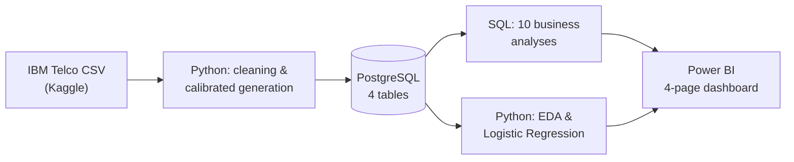

# ProductPulse

**End-to-end product analytics and user behavior intelligence platform for a
B2B SaaS company** — built with SQL, Python, and Power BI on top of a real
customer dataset. No Spark, no Airflow, no cloud warehouse: this is what one
analytics engineer can build in 1-2 weeks with PostgreSQL and a laptop.

## Business Problem

A fictional B2B SaaS company collects three things separately — in-app usage
events, subscription state, and billing history — and nobody has connected
them. Product managers can't answer basic questions: How many customers are
actually active? Is revenue growing because of retention or new sales? Where
in the trial-to-paid journey are people dropping off, and does that differ by
acquisition channel? Which customers are quietly at risk of churning right
now?

My job: build the analytics layer connecting all three data sources, answer
those questions with real SQL analysis, build one genuinely predictive churn
model, and ship an executive dashboard a PM can actually use.

## Tech Stack

| Layer | Tool |
|---|---|
| Database | PostgreSQL |
| Analytics | SQL, Python (pandas, NumPy) |
| Modeling | scikit-learn (Logistic Regression) |
| Visualization | Power BI |
| Version control | Git |

Deliberately not using Spark, Airflow, Kafka, dbt, or a cloud data warehouse —
none of them are necessary at this data volume, and using them anyway would
just be résumé-driven complexity.

## Project Structure

```
ProductPulse/
├── data/
│   ├── raw/            real IBM Telco Customer Churn CSV (committed, 977KB)
│   └── processed/       generated CSVs -- gitignored, ~240MB, reproducible
├── sql/
│   ├── ddl/             schema (4 tables, PK/FK, CHECK constraints, indexes)
│   ├── analysis/        the 10 required business analyses
│   ├── features/        reusable per-user feature tables (EDA + churn model)
│   └── exports/         pre-aggregated queries feeding the Power BI CSVs
├── notebooks/
│   ├── 01_data_cleaning_and_generation.ipynb   real data -> Postgres
│   ├── 02_exploratory_analysis.ipynb           heatmap, segments, correlation
│   └── 03_churn_model.ipynb                    the Logistic Regression model
├── powerbi/
│   ├── data/             CSV exports the dashboard reads from
│   ├── theme.json        blue/white executive theme
│   └── BUILD_GUIDE.md    page-by-page build instructions (DAX, layout)
└── docs/
    └── data_dictionary.md   column-by-column real-vs-synthetic source mapping
```

## Dataset

**Real:** [IBM Telco Customer Churn](https://www.kaggle.com/datasets/blastchar/telco-customer-churn)
(Kaggle, 7,043 customers, 21 columns). Real tenure, contract charges,
`TotalCharges`, and the churn label drive `users`, `subscriptions`, and
`payments` — nothing about revenue or churn outcomes in this project is made
up.

**Synthetic, and clearly labeled as such:** no public dataset pairs
row-level product usage with real subscription billing for the same users —
that combination is commercially sensitive and never released. So the
`events` table (session-level product usage) is generated, calibrated to each
real user's actual tenure and churn outcome rather than drawn independently
of it. A pool of non-converting trial signups is added on top of the real
(already-paying) Telco base, because Telco alone can't provide a real
top-of-funnel. Geography and acquisition channel are synthetic too.

Full column-by-column mapping, every constant, and the reasoning behind each
one: [`docs/data_dictionary.md`](docs/data_dictionary.md).

## Architecture



## Data Model

```mermaid
erDiagram
    USERS ||--o{ EVENTS : generates
    USERS ||--|| SUBSCRIPTIONS : has
    USERS ||--o{ PAYMENTS : makes
    USERS {
        varchar user_id PK
        date signup_date
        varchar country
        varchar acquisition_channel
    }
    EVENTS {
        bigint event_id PK
        varchar user_id FK
        varchar event_name
        varchar feature_name
        timestamp event_timestamp
        varchar session_id
    }
    SUBSCRIPTIONS {
        varchar user_id PK_FK
        varchar plan
        varchar status
        date trial_start
        date paid_date
    }
    PAYMENTS {
        bigint payment_id PK
        varchar user_id FK
        numeric amount
        date payment_date
    }
```

Four tables, proper primary/foreign keys, CHECK constraints on `plan` and
`status`, indexes on every column the analysis queries filter or join on.
Full DDL: [`sql/ddl/01_create_tables.sql`](sql/ddl/01_create_tables.sql).

## Methodology

1. **Data generation** (`notebooks/01_...ipynb`): real Telco data transformed
   into the four tables per the mapping in the data dictionary, with a
   calibrated synthetic event log layered on top. Two real bugs were caught
   and fixed here by actually running the pipeline and checking whether the
   numbers made sense, not just whether the code executed — a first pass
   clipped event history to a trailing window, which would have silently
   broken retention analysis for older cohorts; a second pass anchored every
   user's tenure to the snapshot date regardless of churn status, which made
   every churned customer's payment history run to the present and hid all
   churn from the monthly churn-rate query. Both are documented in the
   notebook and in the git history, not papered over.
2. **SQL analytics** (`sql/analysis/`): the 10 required business analyses,
   written with CTEs, window functions (`LAG`, `ROW_NUMBER`, `RANK`,
   `FIRST_VALUE`), `CASE WHEN`, and `DATE_TRUNC` throughout, run against the
   live 3M+ row dataset and verified against real output at every step.
3. **Python EDA** (`notebooks/02_...ipynb`): retention heatmap, rule-based
   user segmentation, revenue trends, correlation analysis.
4. **Churn model** (`notebooks/03_...ipynb`): one interpretable Logistic
   Regression, built on a genuinely forward-looking, leakage-free setup (see
   below) rather than a naive fit on the current snapshot.
5. **Power BI** (`powerbi/`): pre-aggregated CSV exports plus a page-by-page
   build guide, since Power BI Desktop doesn't run natively on macOS —
   assembled the data and spec here, the report itself on Windows.

## KPIs & Analyses

| # | Analysis | File |
|---|---|---|
| 1 | Daily Active Users | `sql/analysis/01_daily_active_users.sql` |
| 2 | Monthly Active Users (+ stickiness) | `sql/analysis/02_monthly_active_users.sql` |
| 3 | Monthly Recurring Revenue | `sql/analysis/03_monthly_recurring_revenue.sql` |
| 4 | Paying User Growth | `sql/analysis/04_paying_user_growth.sql` |
| 5 | Conversion Funnel | `sql/analysis/05_conversion_funnel.sql` |
| 6 | 7-Day Retention | `sql/analysis/06_retention_7_day.sql` |
| 7 | 30-Day Retention | `sql/analysis/07_retention_30_day.sql` |
| 8 | Cohort Analysis | `sql/analysis/08_cohort_analysis.sql` |
| 9 | Feature Adoption | `sql/analysis/09_feature_adoption.sql` |
| 10 | Churn Rate | `sql/analysis/10_churn_rate.sql` |

## Key Insights

- **Growth:** MRR grew from $32,480 to $319,395/month and MAU from 473 to
  4,732 over six years of simulated history, with monthly churn holding
  steady in a healthy 0.75-1.25% range.
- **The funnel and channel quality tell the same story from both ends.**
  Referral converts trial-to-paid best (86.6%) and churns least (16.7%
  lifetime); Paid Social converts worst (70.2%) and churns most (37.4%). A
  channel that struggles to convert isn't just expensive to acquire from —
  it's also bringing in customers who don't stick.
- **Retention drops fastest in the first week, not gradually.** 7-day and
  30-day retention land in similar ranges across cohorts (~5-15%) — the
  churn that matters most is happening very early, which points at
  onboarding, not long-run engagement decay.
- **Engagement segments predict revenue cleanly.** Power Users are 10.7% of
  the base but average $4,523 in lifetime revenue vs. $1,095 for Casual
  Users — a 4x difference driven entirely by usage breadth and frequency,
  not plan tier.
- **The churn model's most useful finding contradicted my own assumption
  going in.** Raw correlation (Module 6 EDA) said recency-of-last-use was
  the dominant churn signal (r=0.75). A proper leakage-free model — cutoff
  90 days before the most recent data, features computed only from data up
  to that cutoff — found plan tier and revenue matter more: Enterprise
  customers have ~3.4x Basic's churn odds, controlling for behavior. Most of
  what raw recency appeared to explain turned out to run through tenure and
  plan riding along with it. Higher-paying accounts face more renewal
  scrutiny, not less — they are the higher-risk group, not the safer one.

## Business Recommendations

1. **Shift acquisition spend away from Paid Social and Paid Search toward
   Referral and Organic Search** — the latter two outperform on both
   conversion and retention, so this isn't a growth-vs-quality tradeoff.
2. **Fix onboarding, not long-run engagement.** Since most retention loss
   happens in the first week, invest in a guided first-7-days experience
   (e.g. a checklist nudging trial users toward the "Core" features —
   Dashboard, Reports, Integrations — that `09_feature_adoption.sql` shows
   over 70% of all users eventually adopt anyway) rather than generic
   long-term engagement campaigns.
3. **Build a dedicated Enterprise renewal motion.** The churn model's
   headline finding — Enterprise customers churn *more*, not less, once
   behavior is controlled for — suggests renewal risk on the highest-value
   accounts isn't being proactively managed today.
4. **Target retention outreach with the model's predicted probabilities, not
   a fixed rule.** Given the ~2% base rate of near-term churn, rank at-risk
   accounts by `predict_proba` and route the top 5-10% to customer success,
   rather than a blanket "contact everyone inactive 30+ days" policy that
   would flood the team with false positives.

## Power BI Dashboard

Four pages — Executive Overview, User Behaviour, Retention, Conversion
Funnel — built from the pre-aggregated exports in `powerbi/data/` per
[`powerbi/BUILD_GUIDE.md`](powerbi/BUILD_GUIDE.md), in a blue/white executive
theme (`powerbi/theme.json`) matching the accent colors used in the Python
notebooks' plots.

## Churn Model

One interpretable Logistic Regression (`notebooks/03_churn_model.ipynb`),
built on a 90-day-cutoff, leakage-free setup rather than predicting the
current snapshot. ROC-AUC 0.747 on ~100 real churn events — evaluated on
ROC-AUC and recall/precision rather than accuracy, given a 2.2% base rate.
Full feature-importance writeup and business-language interpretation in the
notebook.

## Future Improvements

- Replace the snapshot-style `subscriptions` table with a proper change-history
  table (plan upgrades/downgrades, multiple trial attempts) — deliberately out
  of scope here to keep the schema to four tables as specified.
- A second, real event dataset (e.g. a GA4 sample export) blended in for
  comparison, rather than relying on one calibrated synthetic event log.
- Automate the Power BI refresh against a live Postgres connection once
  running on a machine that can reach it, instead of static CSV exports.
- Expand the churn model beyond Logistic Regression (gradient boosting,
  survival analysis for time-to-churn) once more churn events accumulate —
  ~100 positives is workable for an interpretable linear model but thin for
  anything more complex.
- A proper marketing-attribution "visitor" stage feeding the conversion
  funnel, once that data exists somewhere connectable (see the funnel's
  documented deviation in `docs/data_dictionary.md`).

## Reproducing This

```bash
# 1. Postgres
createdb productpulse
psql -d productpulse -f sql/ddl/01_create_tables.sql

# 2. Python environment
python3 -m venv .venv
.venv/bin/pip install -r requirements.txt
cp .env.example .env   # fill in your local Postgres credentials

# 3. Get the real dataset
# Download from https://www.kaggle.com/datasets/blastchar/telco-customer-churn
# and place WA_Fn-UseC_-Telco-Customer-Churn.csv in data/raw/

# 4. Run the notebooks in order
.venv/bin/jupyter nbconvert --to notebook --execute --inplace notebooks/01_data_cleaning_and_generation.ipynb
.venv/bin/jupyter nbconvert --to notebook --execute --inplace notebooks/02_exploratory_analysis.ipynb
.venv/bin/jupyter nbconvert --to notebook --execute --inplace notebooks/03_churn_model.ipynb

# 5. SQL analyses
psql -d productpulse -f sql/analysis/01_daily_active_users.sql   # ...etc.
```
