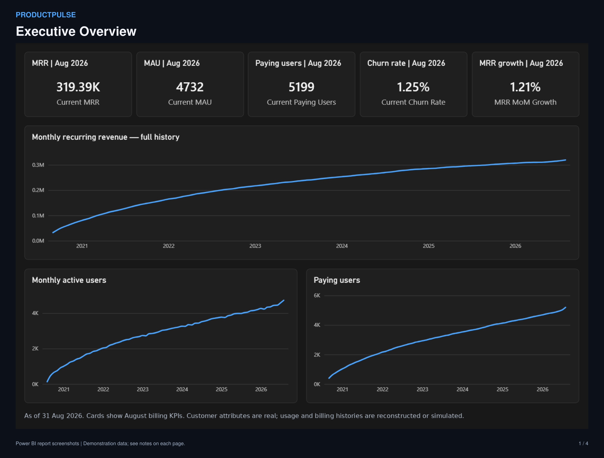
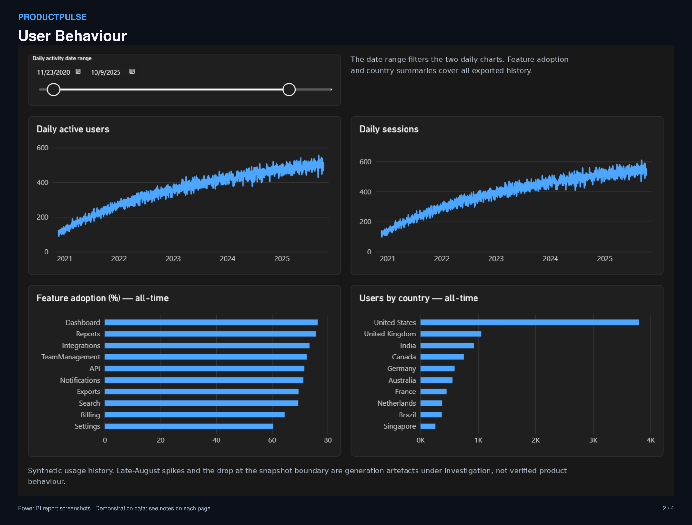
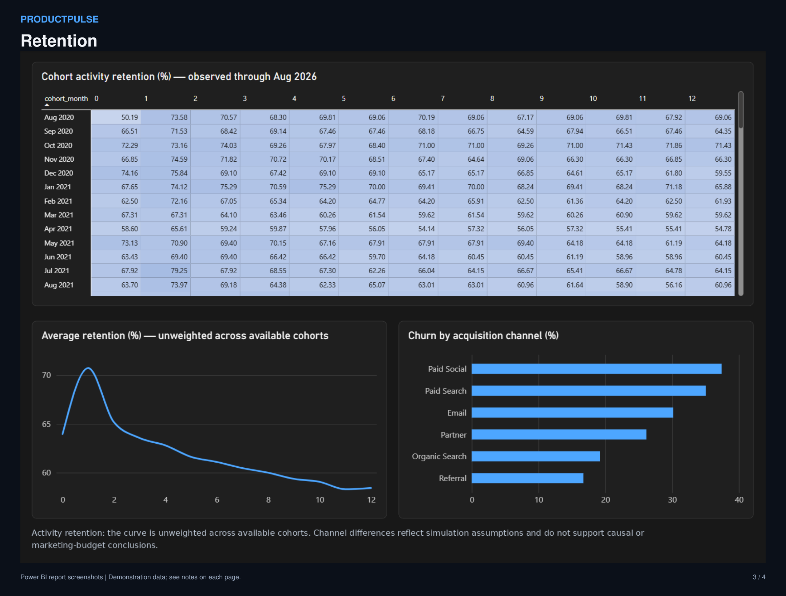
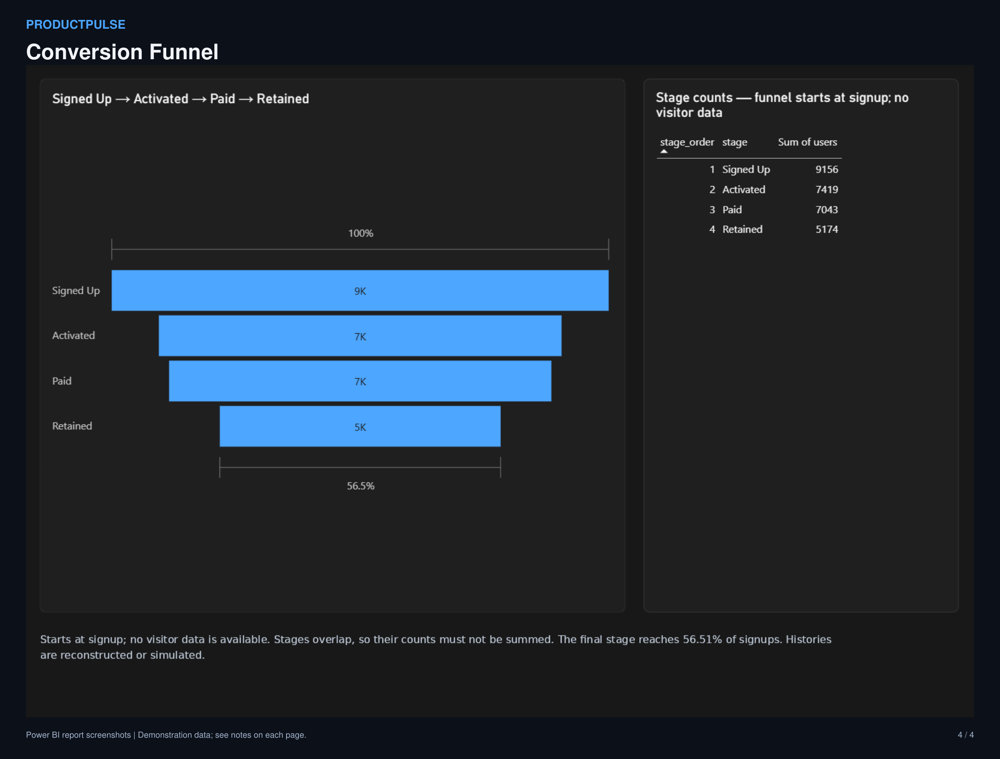
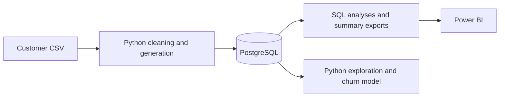
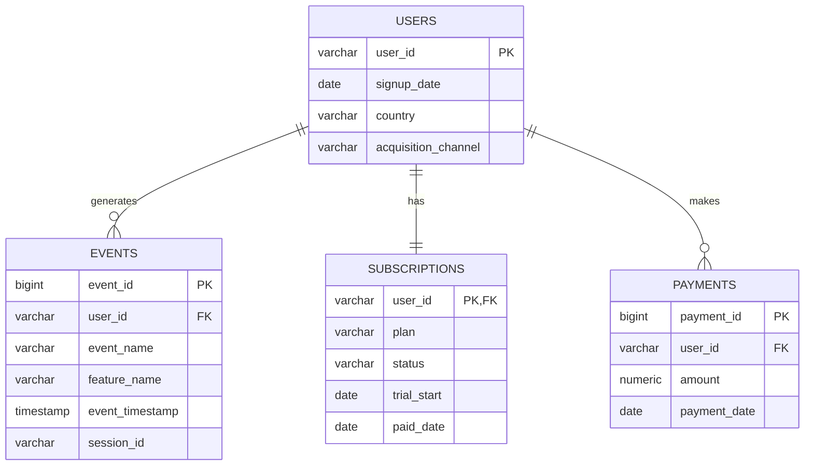

# ProductPulse

SaaS product analytics with PostgreSQL, Python, and Power BI.

ProductPulse tracks revenue, engagement, retention, and conversion across customer accounts, product events, subscriptions, and payments. The project includes ten SQL analyses, three notebooks, a demonstration churn model, and a four-page dashboard.

[Power BI report](powerbi/ProductPulse_Updated.pbix) | [Dashboard PDF](powerbi/ProductPulse-Dashboard.pdf) | [Report guide](powerbi/BUILD_GUIDE.md) | [Data dictionary](docs/data_dictionary.md)



## Dashboard

The Executive Overview brings the five headline metrics together with their monthly trends. The reporting snapshot is **31 August 2026**.

| Metric | Value |
|---|---:|
| Monthly recurring revenue | 319,394.60 |
| Monthly active users | 4,732 |
| Paying users | 5,199 |
| Monthly churn rate | 1.25% |
| Revenue growth from July | 1.21% |

### User Behaviour

Daily active users and sessions respond to the date slicer. Feature adoption and country summaries cover the full exported history.



### Retention

The cohort matrix shows monthly activity retention, alongside an unweighted retention curve and churn by acquisition channel. Period 0 measures activity during the signup month.



### Conversion Funnel

The funnel follows **9,156 signups, 7,419 activated users, 7,043 paid users, and 5,174 retained users**. The final stage represents 56.51% of signups. Stages overlap, so their counts are not additive.



These are static report views. Open the PBIX in Power BI Desktop to use the filters; the [report guide](powerbi/BUILD_GUIDE.md) covers data sources and refresh.

## Data

The source is the [IBM Telco Customer Churn dataset](https://www.kaggle.com/datasets/blastchar/telco-customer-churn): 7,043 customers with tenure, charges, contract details, and churn labels. The source CSV is included in `data/raw/`.

Product events, trial-only accounts, acquisition channels, and geography are simulated. Payment histories and lifecycle dates are reconstructed from the customer snapshot. The resulting dataset has 9,156 accounts and more than three million events. The [data dictionary](docs/data_dictionary.md) documents each field and its assumptions.

## Stack and structure

PostgreSQL stores the four core tables. SQL produces the analyses and dashboard summaries. Python uses pandas, NumPy, scikit-learn, matplotlib, and seaborn for generation, exploration, and modelling.

```text
ProductPulse/
|-- data/raw/       Source customer CSV
|-- data/processed/ Generated tables; kept out of Git
|-- sql/ddl/        Table definitions and indexes
|-- sql/analysis/   Ten business analyses
|-- sql/features/   User and churn-model features
|-- sql/exports/    Dashboard summary queries
|-- sql/validation/ Snapshot boundary checks
|-- notebooks/     Generation, exploration, and churn model
|-- powerbi/        Report, theme, exports, and build guide
|-- scripts/        Validation and report-formatting tools
`-- docs/           Data dictionary and project notes
```



## Data model



The [schema](sql/ddl/01_create_tables.sql) defines primary and foreign keys, checks on plan and subscription status, and indexes for the analysis queries.

## Run locally on Windows

Install Python and PostgreSQL, then open PowerShell in the project folder. Python 3.14 is used by the documented Windows setup. PostgreSQL's `bin` directory must be on PATH to use `createdb` and `psql`.

1. Create a Python environment:

   ```powershell
   python -m venv .venv-local
   .\.venv-local\Scripts\python.exe -m pip install -r requirements.txt
   ```

2. Create `.env` from `.env.example` if it does not already exist, then enter your local PostgreSQL credentials:

   ```dotenv
   PGHOST=localhost
   PGPORT=5432
   PGDATABASE=productpulse
   PGUSER=postgres
   PGPASSWORD="your_password"
   ```

3. Create a dedicated database and its tables:

   ```powershell
   createdb -h localhost -U postgres productpulse
   psql -h localhost -U postgres -d productpulse -v ON_ERROR_STOP=1 -f sql/ddl/01_create_tables.sql
   ```

   The schema script recreates the project tables. Notebook 01 replaces their data, so use a database reserved for this project.

4. Start Jupyter from the notebook directory:

   ```powershell
   cd notebooks
   ..\.venv-local\Scripts\python.exe -m jupyter lab
   ```

   Run `01_data_cleaning_and_generation.ipynb`, then `02_exploratory_analysis.ipynb`, then `03_churn_model.ipynb`. Their relative paths assume the working directory is `notebooks/`.

5. From the project root, run any analysis query:

   ```powershell
   psql -h localhost -U postgres -d productpulse -f sql/analysis/01_daily_active_users.sql
   ```

6. Refresh the dashboard exports and the Power BI report using the [report guide](powerbi/BUILD_GUIDE.md#refresh-the-csvs).

For macOS or Linux, create a virtual environment with `python3 -m venv .venv` and use `.venv/bin/python` for the equivalent Python commands. Create the same `.env` and PostgreSQL database. Power BI Desktop requires Windows.

## SQL analyses

| Analysis | Query |
|---|---|
| Daily active users | [01_daily_active_users.sql](sql/analysis/01_daily_active_users.sql) |
| Monthly active users and stickiness | [02_monthly_active_users.sql](sql/analysis/02_monthly_active_users.sql) |
| Monthly recurring revenue | [03_monthly_recurring_revenue.sql](sql/analysis/03_monthly_recurring_revenue.sql) |
| Paying-user growth | [04_paying_user_growth.sql](sql/analysis/04_paying_user_growth.sql) |
| Conversion funnel | [05_conversion_funnel.sql](sql/analysis/05_conversion_funnel.sql) |
| Seven-day activity retention | [06_retention_7_day.sql](sql/analysis/06_retention_7_day.sql) |
| Thirty-day activity retention | [07_retention_30_day.sql](sql/analysis/07_retention_30_day.sql) |
| Cohort retention | [08_cohort_analysis.sql](sql/analysis/08_cohort_analysis.sql) |
| Feature adoption | [09_feature_adoption.sql](sql/analysis/09_feature_adoption.sql) |
| Churn rate | [10_churn_rate.sql](sql/analysis/10_churn_rate.sql) |

## Validation

Run the offline checks from the project root:

```powershell
python scripts/validate_project.py
```

These check the notebooks, source IDs, saved exports, theme, and report package. They do not execute the notebooks, query PostgreSQL, or render Power BI visuals.

For live database checks, notebook execution, and report refresh, follow the [validation and release checklist](docs/FINISHING_CHECKLIST.md).

## Interpretation and known issues

Usage and acquisition channels are generated using churn outcomes. Model scores and channel differences describe this simulation; they do not establish production predictive performance or causal effects. Activity retention measures product use, rather than permanent subscription retention.

The generator still needs stricter date bounds, and the database load needs a single transaction. Report filters exclude post-snapshot dates but do not correct the underlying histories. See the [project notes](docs/project_review.md) for details and the [validation and release checklist](docs/FINISHING_CHECKLIST.md) for the remaining work.
