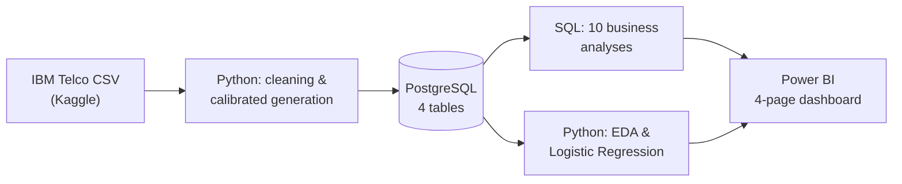

# ProductPulse

**Status: work in progress.** SQL, notebooks, and dashboard exports are present. The Power BI report and a fresh end-to-end verification are pending. See [the review](docs/project_review.md).

**Product analytics portfolio project for a fictional B2B SaaS company** — built with SQL, Python, and Power BI on top of a real
customer snapshot plus simulated histories. No Spark, no Airflow, no cloud warehouse: this is what one
analytics engineer can build in 1-2 weeks with PostgreSQL and a laptop.

## Business Problem

A fictional B2B SaaS company collects three things separately — in-app usage
events, subscription state, and billing history — and nobody has connected
them. Product managers can't answer basic questions: How many customers are
actually active? Is revenue growing because of retention or new sales? Where
in the trial-to-paid journey are people dropping off, and does that differ by
acquisition channel? Which customers are quietly at risk of churning right
now?

My job: build the analytics layer connecting all three data sources, answer
those questions with real SQL analysis, build one demonstration churn
model, and ship an executive dashboard a PM can actually use.

## Tech Stack

| Layer | Tool |
|---|---|
| Database | PostgreSQL |
| Analytics | SQL, Python (pandas, NumPy) |
| Modeling | scikit-learn (Logistic Regression) |
| Visualization | Power BI |
| Version control | Git |

Deliberately not using Spark, Airflow, Kafka, dbt, or a cloud data warehouse —
none of them are necessary at this data volume, and using them anyway would
just be résumé-driven complexity.

## Project Structure

```
ProductPulse/
├── data/
│   ├── raw/            real IBM Telco Customer Churn CSV (committed, 977KB)
│   └── processed/       generated CSVs -- gitignored, ~240MB, reproducible
├── sql/
│   ├── ddl/             schema (4 tables, PK/FK, CHECK constraints, indexes)
│   ├── analysis/        the 10 required business analyses
│   ├── features/        reusable per-user feature tables (EDA + churn model)
│   └── exports/         pre-aggregated queries feeding the Power BI CSVs
├── notebooks/
│   ├── 01_data_cleaning_and_generation.ipynb   real data -> Postgres
│   ├── 02_exploratory_analysis.ipynb           heatmap, segments, correlation
│   └── 03_churn_model.ipynb                    the Logistic Regression model
├── powerbi/
│   ├── data/             CSV exports the dashboard reads from
│   ├── theme.json        blue/white executive theme
│   └── BUILD_GUIDE.md    page-by-page build instructions (DAX, layout)
└── docs/
    └── data_dictionary.md   column-by-column real-vs-synthetic source mapping
```

## Dataset

**Real:** [IBM Telco Customer Churn](https://www.kaggle.com/datasets/blastchar/telco-customer-churn)
(Kaggle, 7,043 customers, 21 columns). Real tenure, contract charges,
`TotalCharges`, and the churn label drive `users`, `subscriptions`, and
`payments` — the source charge and churn attributes are real, but payment history and churn timing are reconstructed or simulated.

**Synthetic, and clearly labeled as such:** no public dataset pairs
row-level product usage with real subscription billing for the same users —
that combination is commercially sensitive and never released. So the
`events` table (session-level product usage) is generated, calibrated to each
real user's actual tenure and churn outcome rather than drawn independently
of it. A pool of non-converting trial signups is added on top of the real
(already-paying) Telco base, because Telco alone can't provide a real
top-of-funnel. Geography and acquisition channel are synthetic too.

Full column-by-column mapping, every constant, and the reasoning behind each
one: [`docs/data_dictionary.md`](docs/data_dictionary.md).

## Architecture



## Data Model

```mermaid
erDiagram
    USERS ||--o{ EVENTS : generates
    USERS ||--|| SUBSCRIPTIONS : has
    USERS ||--o{ PAYMENTS : makes
    USERS {
        varchar user_id PK
        date signup_date
        varchar country
        varchar acquisition_channel
    }
    EVENTS {
        bigint event_id PK
        varchar user_id FK
        varchar event_name
        varchar feature_name
        timestamp event_timestamp
        varchar session_id
    }
    SUBSCRIPTIONS {
        varchar user_id PK_FK
        varchar plan
        varchar status
        date trial_start
        date paid_date
    }
    PAYMENTS {
        bigint payment_id PK
        varchar user_id FK
        numeric amount
        date payment_date
    }
```

Four tables, proper primary/foreign keys, CHECK constraints on `plan` and
`status`, indexes on every column the analysis queries filter or join on.
Full DDL: [`sql/ddl/01_create_tables.sql`](sql/ddl/01_create_tables.sql).

## Methodology

1. **Data generation** (`notebooks/01_...ipynb`): real Telco data transformed
   into the four tables per the mapping in the data dictionary, with a
   calibrated synthetic event log layered on top. Two real bugs were caught
   and fixed here by actually running the pipeline and checking whether the
   numbers made sense, not just whether the code executed — a first pass
   clipped event history to a trailing window, which would have silently
   broken retention analysis for older cohorts; a second pass anchored every
   user's tenure to the snapshot date regardless of churn status, which made
   every churned customer's payment history run to the present and hid all
   churn from the monthly churn-rate query. Both are documented in the
   notebook and in the git history, not papered over.
2. **SQL analytics** (`sql/analysis/`): the 10 required business analyses,
   written with CTEs, window functions (`LAG`, `ROW_NUMBER`, `RANK`,
   `FIRST_VALUE`), `CASE WHEN`, and `DATE_TRUNC` throughout, run against the
   live 3M+ row dataset and verified against real output at every step.
3. **Python EDA** (`notebooks/02_...ipynb`): retention heatmap, rule-based
   user segmentation, revenue trends, correlation analysis.
4. **Churn model** (`notebooks/03_...ipynb`): one interpretable Logistic
   Regression, using pre-cutoff features; see the model limitations below.
5. **Power BI** (`powerbi/`): pre-aggregated CSV exports plus a page-by-page
   build guide, since Power BI Desktop doesn't run natively on macOS —
   the report still needs to be assembled and saved on Windows.

## KPIs & Analyses

| # | Analysis | File |
|---|---|---|
| 1 | Daily Active Users | `sql/analysis/01_daily_active_users.sql` |
| 2 | Monthly Active Users (+ stickiness) | `sql/analysis/02_monthly_active_users.sql` |
| 3 | Monthly Recurring Revenue | `sql/analysis/03_monthly_recurring_revenue.sql` |
| 4 | Paying User Growth | `sql/analysis/04_paying_user_growth.sql` |
| 5 | Conversion Funnel | `sql/analysis/05_conversion_funnel.sql` |
| 6 | 7-Day Retention | `sql/analysis/06_retention_7_day.sql` |
| 7 | 30-Day Retention | `sql/analysis/07_retention_30_day.sql` |
| 8 | Cohort Analysis | `sql/analysis/08_cohort_analysis.sql` |
| 9 | Feature Adoption | `sql/analysis/09_feature_adoption.sql` |
| 10 | Churn Rate | `sql/analysis/10_churn_rate.sql` |

## Results and limitations

The saved CSV exports and notebook outputs demonstrate the analytics pipeline on a mixture of real source attributes and simulated histories. They have not been regenerated during the current review.

- Acquisition channels are generated conditional on churn labels. Channel differences reflect generator assumptions and cannot justify real marketing budget decisions.
- Exact day-7/day-30 activity retention does not measure permanent customer loss or prove that most churn happens in the first week.
- Usage rates vary by generated plan tier, so engagement/revenue associations do not isolate behavior from plan effects.
- The churn notebook uses pre-cutoff activity, but outcome-conditioned simulation and future-informed population selection prevent a claim of leakage-free real-world prediction. Its saved ROC-AUC is a demonstration result, not production validation.

## Power BI Dashboard

Seven CSV exports, a theme, and a [build guide](powerbi/BUILD_GUIDE.md) are included. The four-page `.pbix` report and screenshots are **not yet included**.

## Future Improvements

- Replace the snapshot-style `subscriptions` table with a proper change-history
  table (plan upgrades/downgrades, multiple trial attempts) — deliberately out
  of scope here to keep the schema to four tables as specified.
- A second, real event dataset (e.g. a GA4 sample export) blended in for
  comparison, rather than relying on one calibrated synthetic event log.
- Automate the Power BI refresh against a live Postgres connection once
  running on a machine that can reach it, instead of static CSV exports.
- Expand the churn model beyond Logistic Regression (gradient boosting,
  survival analysis for time-to-churn) once more churn events accumulate —
  ~100 positives is workable for an interpretable linear model but thin for
  anything more complex.
- A proper marketing-attribution "visitor" stage feeding the conversion
  funnel, once that data exists somewhere connectable (see the funnel's
  documented deviation in `docs/data_dictionary.md`).

## Reproducing This

```bash
# 1. Postgres
createdb productpulse
psql -d productpulse -f sql/ddl/01_create_tables.sql

# 2. Python environment
python3 -m venv .venv
.venv/bin/pip install -r requirements.txt
cp .env.example .env   # fill in your local Postgres credentials

# 3. Get the real dataset
# Download from https://www.kaggle.com/datasets/blastchar/telco-customer-churn
# and place WA_Fn-UseC_-Telco-Customer-Churn.csv in data/raw/

# 4. Run the notebooks in order
.venv/bin/jupyter nbconvert --to notebook --execute --inplace notebooks/01_data_cleaning_and_generation.ipynb
.venv/bin/jupyter nbconvert --to notebook --execute --inplace notebooks/02_exploratory_analysis.ipynb
.venv/bin/jupyter nbconvert --to notebook --execute --inplace notebooks/03_churn_model.ipynb

# 5. SQL analyses
psql -d productpulse -f sql/analysis/01_daily_active_users.sql   # ...etc.
```

## Offline validation

Run `python scripts/validate_project.py` from the repository root. This checks notebook syntax, stored errors, source IDs, and saved dashboard consistency without connecting to PostgreSQL. It does not replace an end-to-end run.

## Windows setup

Use Python 3.14 and PostgreSQL. From the repository root:

```powershell
python -m venv .venv-local
.\.venv-local\Scripts\python.exe -m pip install -r requirements.txt
Copy-Item .env.example .env
# Edit .env with your local database credentials.
createdb -U postgres productpulse
psql -U postgres -d productpulse -f sql/ddl/01_create_tables.sql
.\.venv-local\Scripts\python.exe -m jupyter lab
```

Use your PostgreSQL username if different and ensure its tools are on PATH. Open the notebooks in order with their working directory set to `notebooks/`. The existing local Unix virtual environment is not portable to Windows.

Use a dedicated database: the DDL drops the project tables, and notebook 01 replaces their data. The source CSV is already included. Regenerating data also requires refreshing the dashboard exports using `sql/exports/` and `sql/analysis/08_cohort_analysis.sql`.
